# PaperLens

> 点一个公式，跳到实现它的代码行；读完一篇 paper，带走一份能交接的复现清单。

PaperLens 是一个「读懂 → 能跑」的论文阅读与复现工作台。导入一篇论文，它按你的身份讲给你听，把公式指到实现它的代码行，再给你一份能交接的复现清单。

它不追求把论文总结得更短，它追求把「读完」推到「能跑」。

> **源码暂不开源。** 这个仓库只用来介绍项目、放截图和入口。想看代码、想合作，见文末联系方式。

## 在线体验

- 作品地址：https://paperlens-hzdhrv29btl.qoder.zone/
- 演示账号：`paperlens.demo@example.com` / `demo1234`
- 演示账号是只读的：预置内容的修改与删除会被服务端拒绝，这是刻意的保护。

演示账号里预置了 3 篇论文（Attention Is All You Need / An Image is Worth 16x16 Words / LoRA）× 3 种身份的解读、3 篇对照译文、LoRA 的一组预置问答，以及一个进度 3/6 的复现项目。登录即看，不用填密钥、不用等模型。

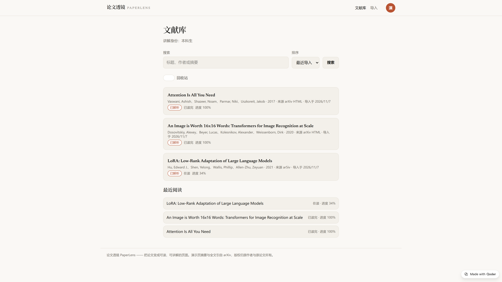

## 三条主线

### 1. 身份化解读

同一篇论文，本科生需要补基础，研究生需要判断能不能复现，导师需要评估价值。PaperLens 让你选定身份（本科生 / 研究生 / 导师），按该口径生成摘要、分段讲解与注意事项；解读页底部的身份卡可随时切换，三种讲法并存，按「论文 × 身份」缓存，二次打开秒开。

解读里的原文标号可以点，跳回原文并整段高亮。

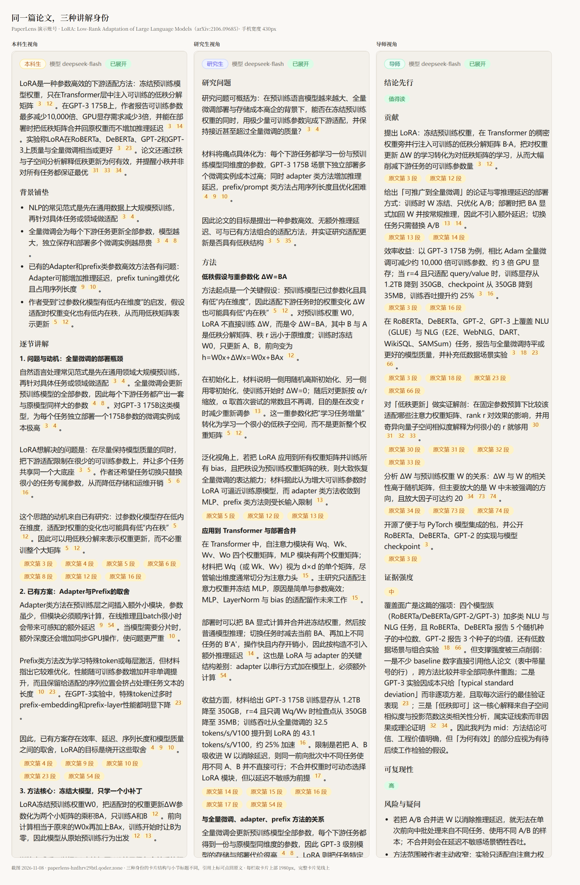

### 2. 公式 ↔ 代码

阅读页点任一公式，直接跳到实现它的代码行。演示里的 LoRA 点 `examples/NLG/src/model.py:94` 就落到第 94 行高亮，右侧是中文注释；映射有误可以手动改正。把「这个公式到底怎么写的」从半小时翻仓库，变成一次点击。

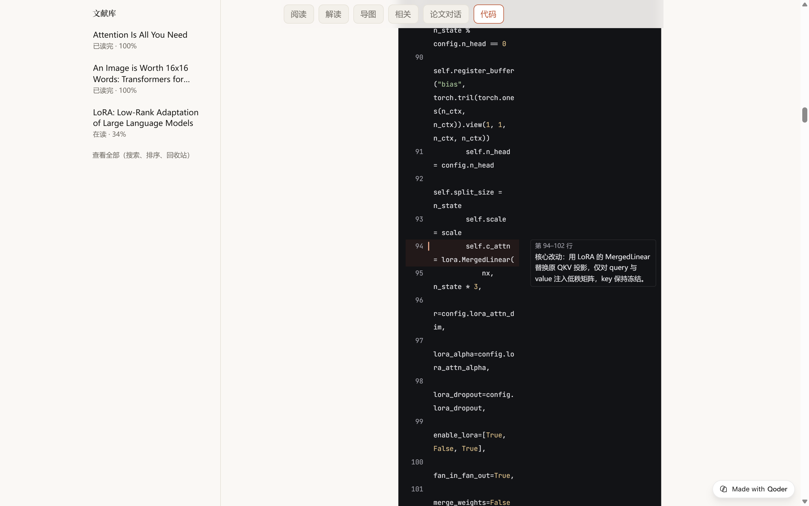

### 3. 复现工作台

从 AI 初始评估起步，落到五张可编辑清单：**实验步骤 / 数据与权重资产 / 论文未写明的隐性细节 / 已知卡点 / 运行记录**，每条带状态与备注。再生成可复现环境方案与交接文档，一键下载复现包。

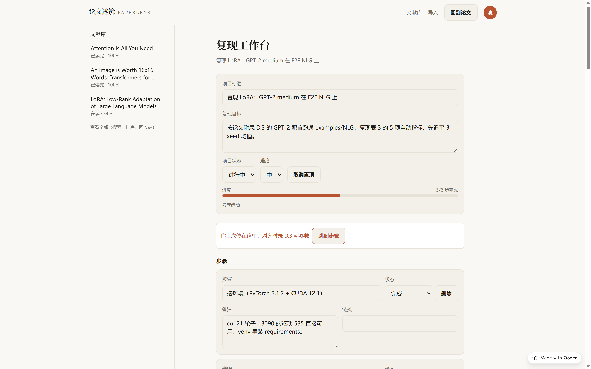

点「用 Qoder 复现」下载 `qoder-repro-pack.zip`：环境文件（`environment.yml`、`requirements.txt`、`setup.sh` / `setup.ps1`）、五张清单、公式-代码映射、论文摘要，外加执行规则 `AGENTS.md` 和一段可直接粘贴的提示词。解压到论文仓库目录交给 Qoder，它先读规则与环境文件，用 conda 建独立环境，每条命令说明后等你确认，跑完把实际版本与清单预填值逐项对比，差异写回运行记录。包里不放论文正文、仓库代码和任何密钥。

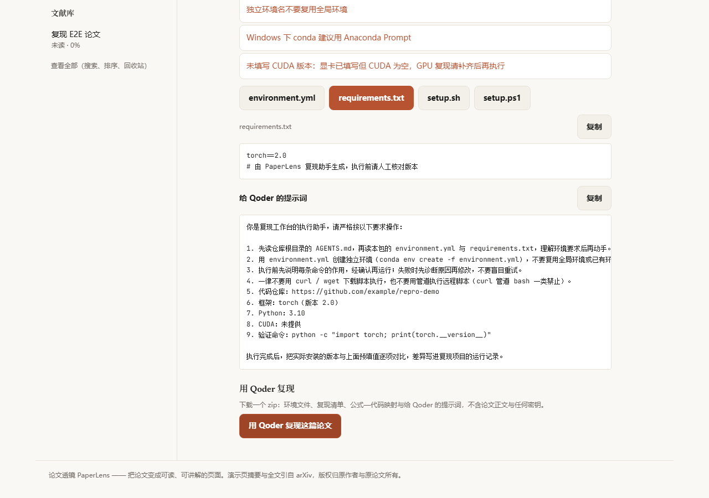

## 辅助能力

- **导入四入口**：粘贴正文（支持拖入 PDF，文本在浏览器内提取，不上传）/ arXiv 链接或 ID / DOI（查 Crossref 补元数据）/ 内置 arXiv 检索；重复导入提示「已在库中」。
- **阅读辅助**：术语弹窗、引用锚点、LaTeX 公式渲染；排版按论文结构分栏，公式与代码块不破版；375px 手机宽可用。
- **论文对话**：送进模型的是本文分段（最多 80 段、约 8 万字，带编号）加最近 6 条历史；回答里的 `[S]` 标号入库前必须落在实际送进模型的分段编号里，越界不落库；回答可点回原文，不满意可重新生成（旧回答软删）。
- **对照翻译**：按段落分批生成，参考文献不译，可停可续，结果按段落缓存。
- **思维导图**：按当前身份生成，可展开收起，点节点只看一支。
- **相关论文**：最多 5 条，每条标注来源理由；Semantic Scholar 为主，失败回退 arXiv 检索。
- **接入自己的模型**：预置 7 家服务商（通义 DashScope / DeepSeek / Kimi / 智谱 / 火山方舟 / 硅基流动 / OpenAI）与自定义端点，选中自动填接口地址，可先「测试连接」。密钥保存在浏览器里，随请求头传给服务端，服务端只在本次请求内存中使用——不写数据库、不写日志、不在页面回显。

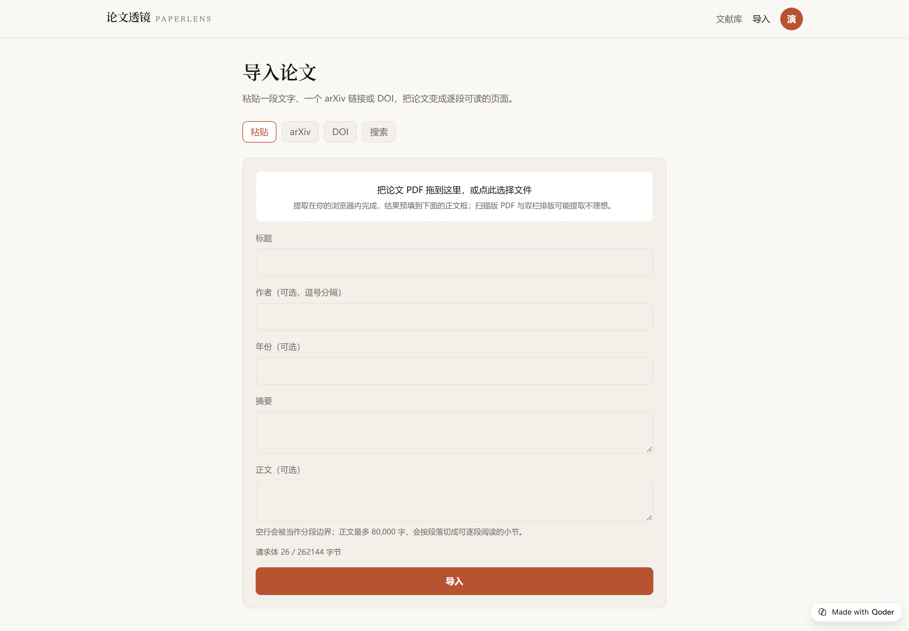
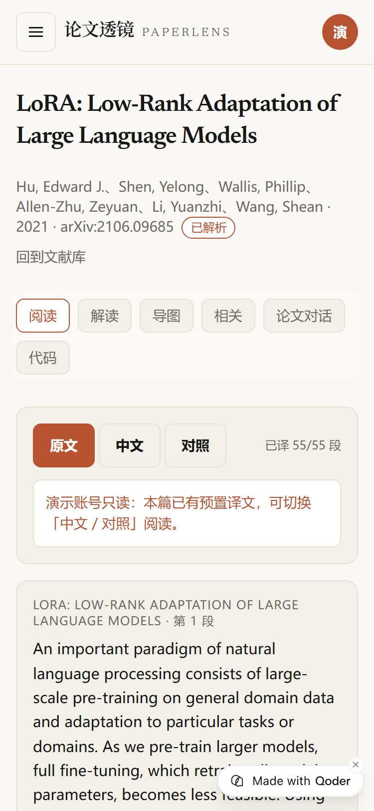
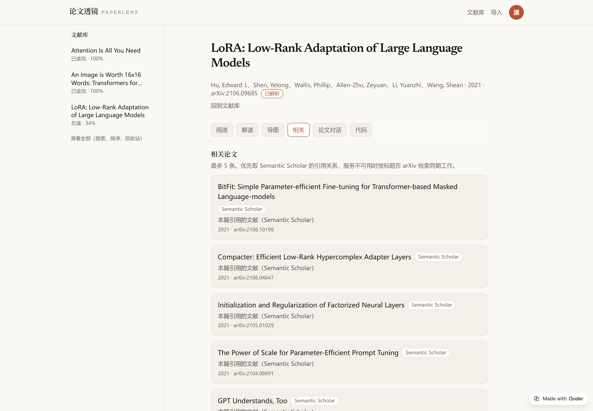
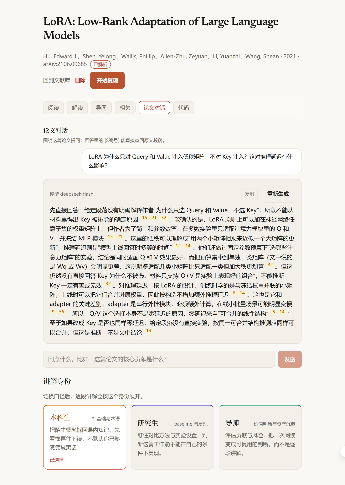
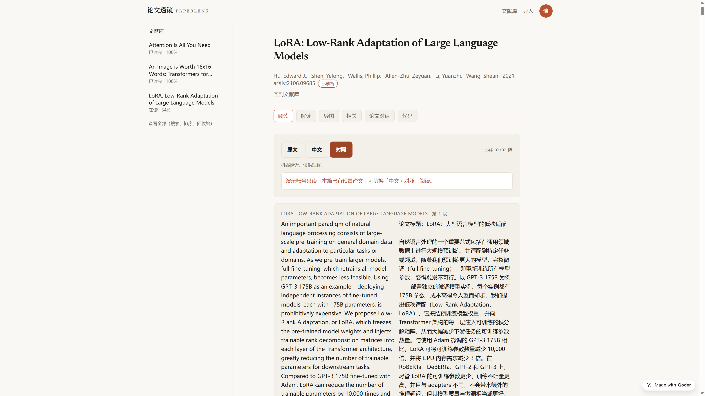
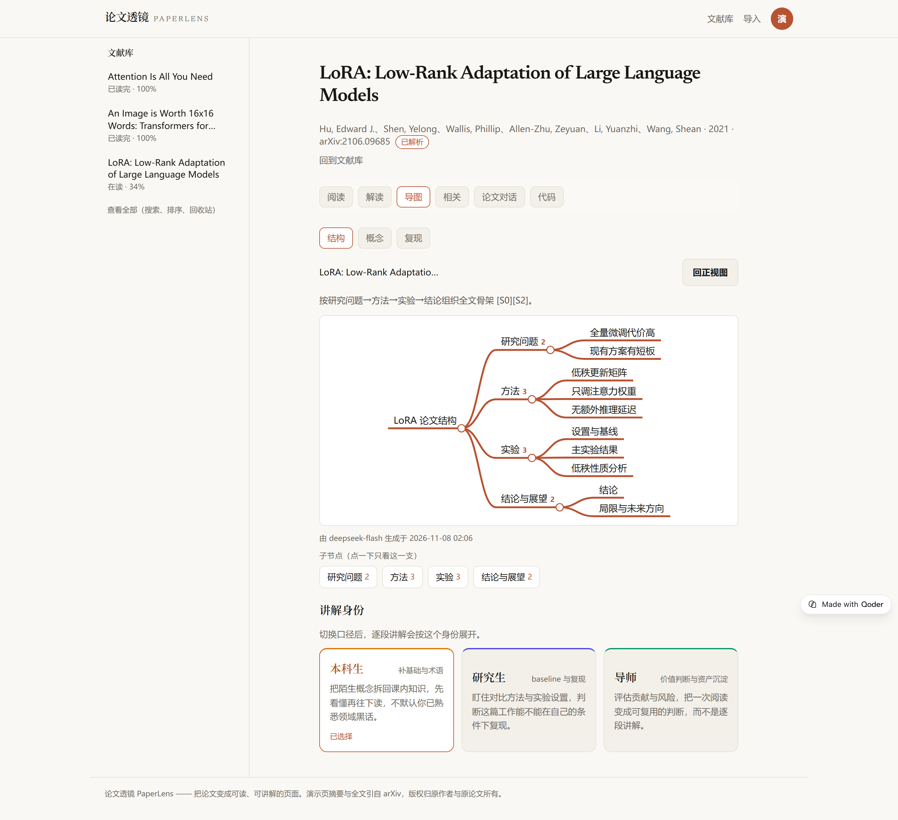
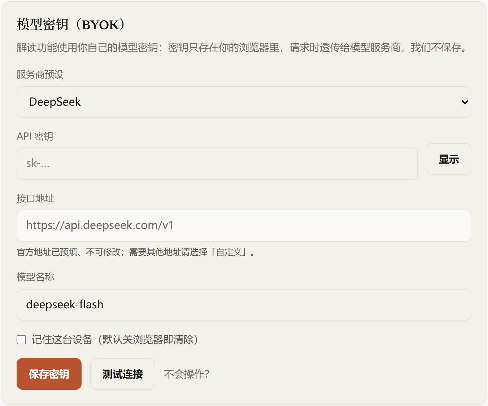

## 怎么做的

工程形态：前端 React + TypeScript 单页应用，后端收敛为单个 Edge Function，通过 Qoder Sites 部署。开发与部署全程在 Qoder 内完成。

不是一句「AI 帮我写的」，是把 AI 放进一套能验收的流程里：

1. **先立规则再写代码**：仓库根目录的 `AGENTS.md` 是 167 行项目宪法——契约先行、错误码由 parity 测试守着、没实测的能力必须标「未验证」、不动未提交的改动、我不说「发布」就不发布。
2. **一个 Task 一本账**：9 个阶段计划、前后 13 份账本，记基线提交、设计章节、允许改动的文件，并做冲突预扫；一个 Task 一个提交。
3. **写的人和审的人不是同一个**：每个 Task 一个实现子智能体，另派复审只看 diff，按 Critical / Important / Minor 出结论，我逐条裁决。
4. **开工前汇报，收工后人判**：开工前说清做什么、改哪些文件、怎么验收；收工交「审一眼」（提交号、复审结论、待人判条目、门禁结果），然后停手。

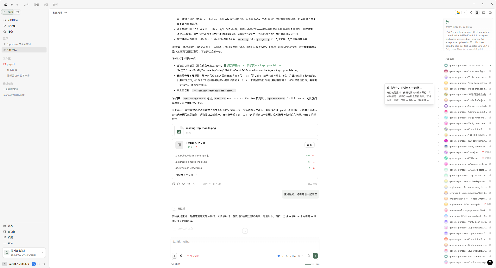
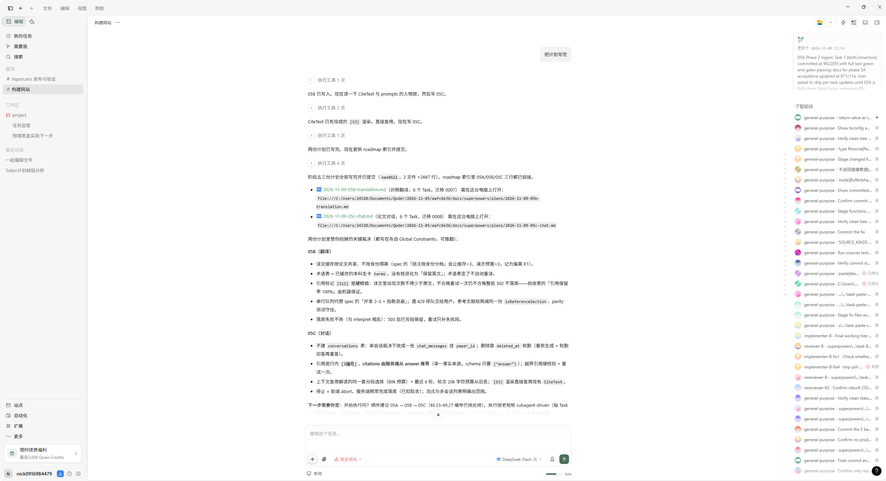
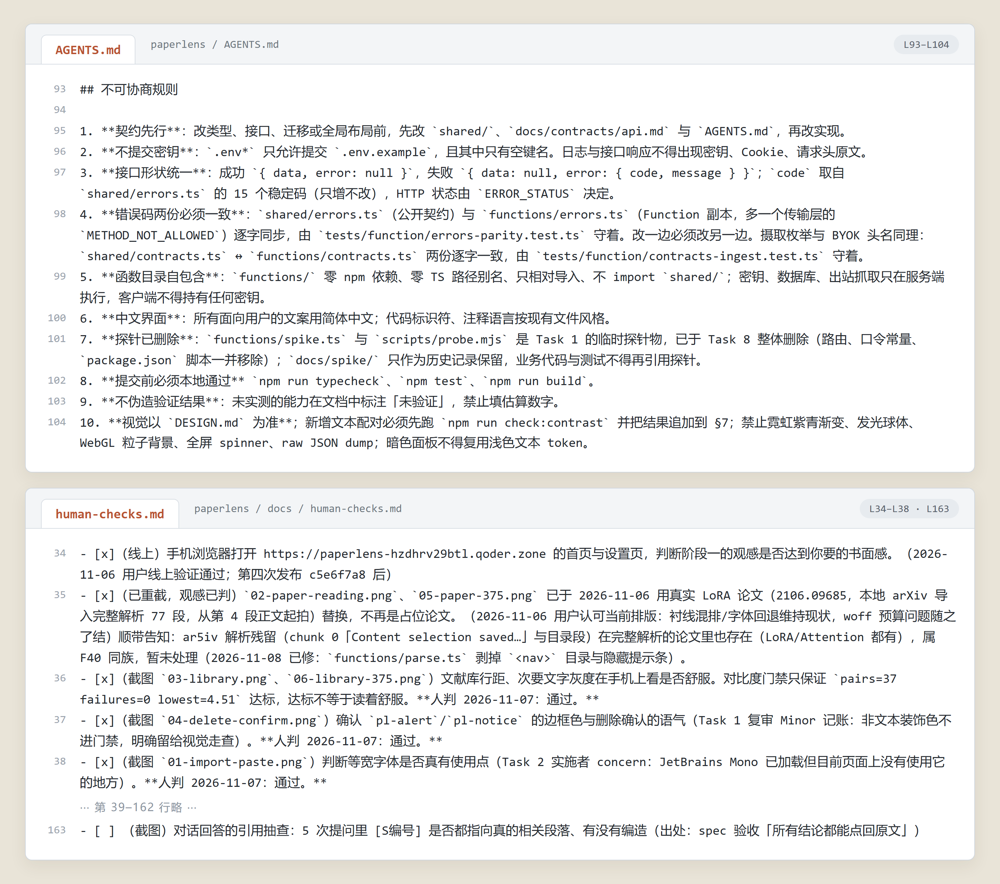

## 源码说明

这个仓库**不包含**任何产品源码、数据库结构或密钥。项目代码保存在私有仓库，暂不公开。原因很实际：里面有多处与线上部署、第三方模型调用相关的配置，公开前需要单独做一轮脱敏与审计。

需要看代码、做技术交流、或者想把它用在自己的课题组，可以按下面的方式找我。

## 如果它对你有帮助

我在参加 2026 Qoder 高校创造力大赛（StudyHack 学习科研赛道），参赛帖在这里：

**https://tianchi.aliyun.com/forum/post/1096694**

如果这个项目对你有用，欢迎去帖子里点个赞、留句话支持一下——这对我很重要。也欢迎直接打开上面的作品地址试一遍，任何问题和建议都可以提给我。

## 联系

- 作者：徐捷，大连理工大学人工智能专业
- 作品地址：https://paperlens-hzdhrv29btl.qoder.zone/
- Qoder 账号：nick0916984479

---

本仓库中的截图与文字为项目介绍用途；产品源码版权归作者所有，未经授权不得复制或再分发。
